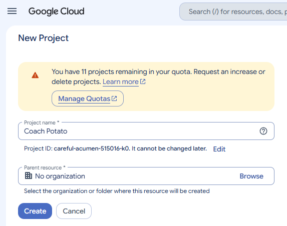
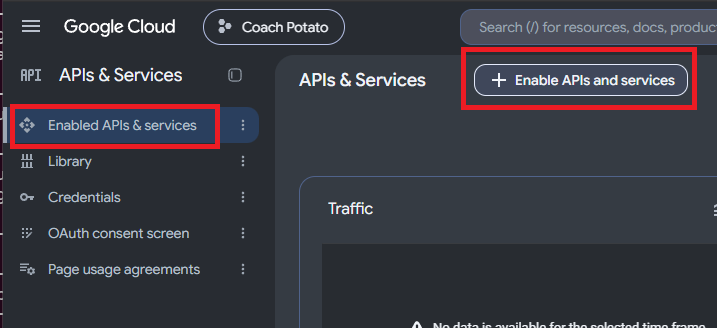
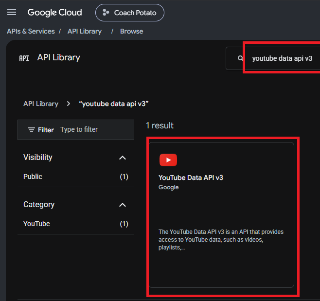
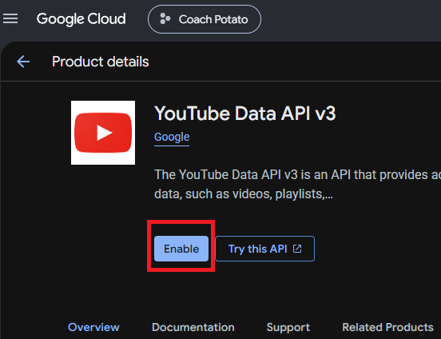
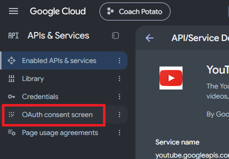
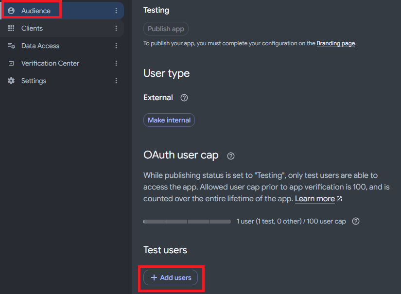
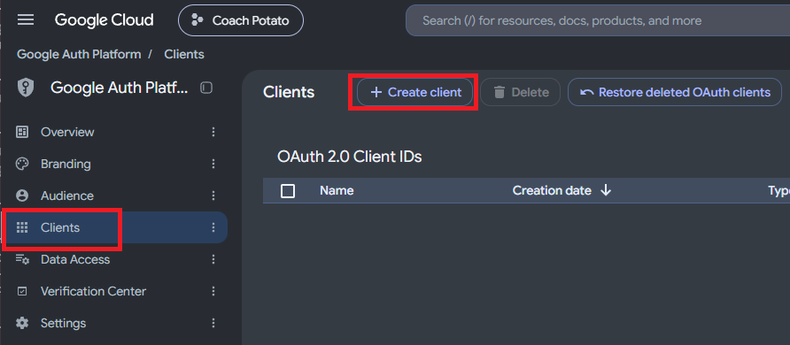
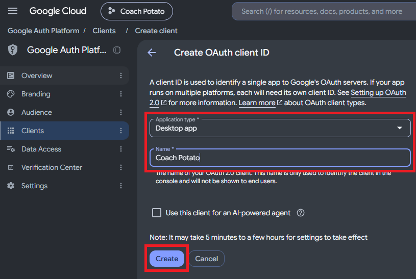
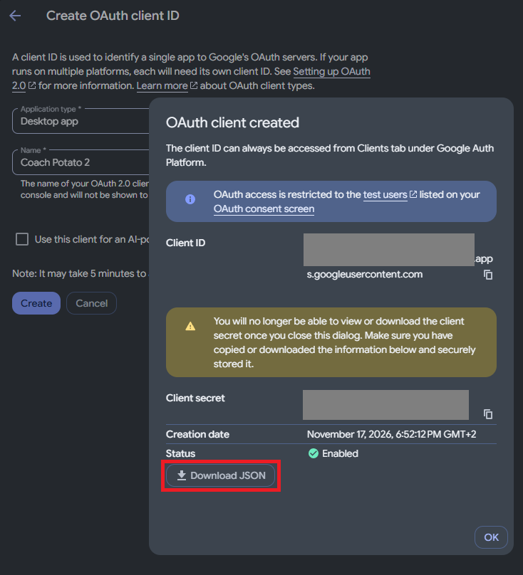

# Setting up one-click YouTube upload

Every recording in Coach Potato already has a **Manual upload** button that
needs no setup: it opens youtube.com/upload, copies the video's path and shows
it in Explorer. It uploads to whichever channel your browser has selected.

One-click upload sends the video from inside the app instead, with the title
and the chapter-per-death description already filled in. It needs a free
Google Cloud "OAuth client" of your own, because the upload runs as you, on
your channel. Setup takes about ten minutes, once.

Before you start, know Google's limits for a personal project like this:

| | |
|---|---|
| Video privacy | **Always private** until Google audits the project (you can make it unlisted/public on YouTube afterwards) |
| Uploads per day | About **6** (each upload costs 1,600 of the default 10,000 daily quota units) |
| Sign-in lasts | **7 days** while the app is in *Testing* — see step 7 to remove that |

## 1. Create a Google Cloud project

Open <https://console.cloud.google.com/projectcreate> and sign in with any
Google account. Name the project (e.g. `Coach Potato`), leave *Parent resource*
as *No organization*, and click **Create**.

Make sure the new project is selected in the project picker at the top of the
page (the pill next to the Google Cloud logo) for every following step.

## 2. Enable the YouTube Data API v3

Open **APIs & Services** (☰ menu, or
<https://console.cloud.google.com/apis/dashboard>) and click **Enable APIs and
services**.

Search for `youtube data api v3` and open the **YouTube Data API v3** result.

Click **Enable**.

(Shortcut: <https://console.cloud.google.com/apis/library/youtube.googleapis.com>
opens that page directly.)

## 3. Set up the consent screen

In the **APIs & Services** sidebar, click **OAuth consent screen**. It takes
you to the *Google Auth Platform*.

Click **Get started** and fill in:

- **App name**: `Coach Potato` (anything — only you will see it)
- **User support email**: your email
- **Audience**: **External**
- **Contact information**: your email
- Agree to the policy → **Create**

## 4. Add yourself as a test user

In the Google Auth Platform sidebar, open **Audience**, scroll to **Test
users** and click **Add users**. Add the Google account **that owns your
YouTube channel** and save.

Skipping this is the most common setup problem: sign-in then fails with
*"Access blocked: … has not completed the Google verification process"*.

## 5. Create a Desktop app client and download its JSON

Open **Clients** in the same sidebar and click **Create client**.

- **Application type**: **Desktop app** (not *Web application*)
- **Name**: anything, e.g. `Coach Potato`

Click **Create**.

A dialog shows the new client. Click **Download JSON** **before closing it**:
Google never shows the client secret again after this dialog. If you closed it
already, just create another client.

Google notes that a new client can take from a few minutes up to a few hours
to start working. If sign-in fails right away with a client error, wait a bit
and try again.

## 6. Load it in Coach Potato and sign in

Settings → **Recordings** → *Uploading to YouTube*:

1. **Choose client file…** and pick the downloaded JSON. Coach Potato keeps its
   own copy, so you can delete the download afterwards.
2. **Sign in with Google**. A browser tab opens:
   - choose the Google account from step 4;
   - if that account manages several channels (brand accounts), Google asks
     which one — **that's the channel uploads go to**;
   - Google warns that it **hasn't verified this app** — it's your own app, so
     click **Continue**, then allow the permissions (upload videos, and view
     your channel so the app can show which channel it's using).
3. The card now says *Uploads go to <your channel>*. **Test** re-checks
   everything at any time; **Switch channel** signs in again so you can pick
   a different account or channel.

## 7. Optional: stop the weekly re-sign-in

While the app's publishing status is *Testing*, Google expires the sign-in
after 7 days, and you'll be asked to sign in again. To avoid that, open
<https://console.cloud.google.com/auth/audience> and click **Publish app**. You
don't need to submit it for verification: you'll just keep seeing the
"unverified app" warning when signing in, which is expected for a personal
project.

## Troubleshooting

**Test configuration** names each problem and how to fix it. The common ones:

| Message | Fix |
|---|---|
| This is a Web application client | Create a new client with type **Desktop app** (step 5) |
| Not enabled for this Google Cloud project | Enable the API (step 2) in the **same** project as the client |
| Google refused the sign-in (access_denied) | Add your account as a test user (step 4) |
| The saved sign-in no longer works | Sign in again; see step 7 to stop it expiring |
| invalid_client / redirect_uri_mismatch right after creating the client | Wait a few minutes (new clients can take a while), and check it's a **Desktop app** client |
| Today's quota is used up | Wait until midnight Pacific time, or use **Manual upload** |
